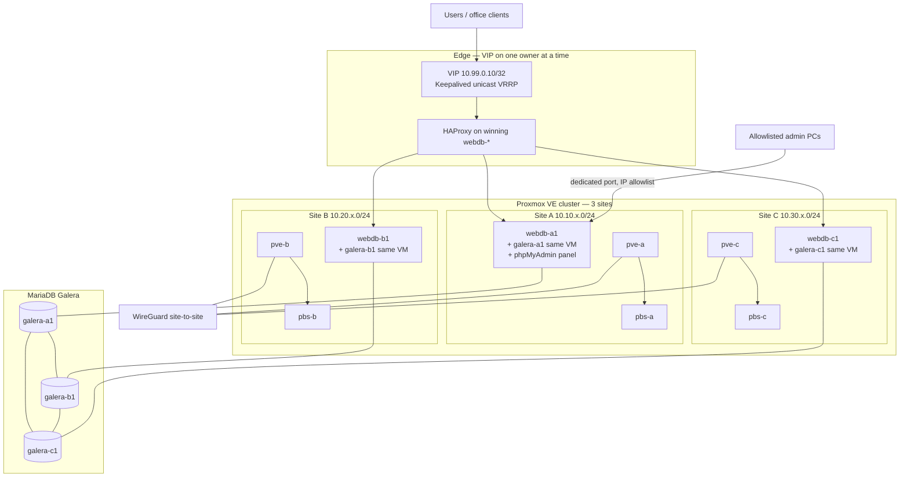

# Multi-site Proxmox HA lab

Portfolio documentation for a **three-site high-availability** stack I designed and operate in production (details anonymized).

One Proxmox VE cluster spans three geographic sites. Application traffic lands on a floating VIP (Keepalived / unicast VRRP) in front of HAProxy on the **current** owner VM. Data is a synchronous MariaDB Galera ring (one member per site app VM). Sites talk over WireGuard with **per-site RFC1918 prefixes** (no stretched L2). Backups go to Proxmox Backup Server. Internal git and web content sync use Gitea and Syncthing. Database maintenance goes through an IP-allowlisted phpMyAdmin panel that is kept off the public path.

> **Anonymization.** No real company name, hostnames, domains, public IPs, usernames or passwords. Addresses use RFC 1918 / RFC 5737 examples. Secrets are placeholders (`<CHANGE_ME>`, `<PRIVATE_KEY>`, …). Open `TODO` markers are left where production values belong.

## Architecture



VIP ownership: Keepalived runs on each `webdb-*` with **state BACKUP** and different priorities; only one owns `10.99.0.10/32` at a time. HAProxy that serves the VIP is the instance on that same VM. Galera member `galera-a1` is the MariaDB on `webdb-a1` (not a separate guest).

## Stack

| Layer | Choice | Role |
| --- | --- | --- |
| Hypervisor | Proxmox VE (3 nodes, 3 sites) | Single cluster, HA enabled |
| Backup | Proxmox Backup Server (one VM per node) | Snapshot backups of app VMs |
| Database | MariaDB Galera (synchronous) | Multi-master SQL, quorum-aware |
| SQL proxy | ProxySQL on each app VM | Local write preference, read fan-out |
| DB admin | phpMyAdmin on one app VM (dedicated Apache vhost) | Maintenance panel, IP allowlist + cookie login |
| Edge | HAProxy + Keepalived (unicast VRRP VIP) | HTTP distribute + floating `10.99.0.10/32` |
| Site links | WireGuard mesh | Encrypted overlay; `AllowedIPs` = per-site prefixes |
| Switching | VLAN per NIC role (no single-slave bond in examples) | Mgmt+services on NIC0; cluster+storage on NIC1 |
| Code & files | Gitea + Syncthing | Internal git; sync of web document root |
| OS (guests) | Ubuntu LTS on app VMs | Apache / PHP / MariaDB stack |

Exact package versions and disk sizes: **TODO** (fill from your inventory).

## Design decisions

### Why Galera (synchronous)?

The application is a classic LAMP workload that must see the same rows on every site immediately after a write. Asynchronous replicas would force sticky sessions or accept stale reads across sites. Galera keeps a single logical dataset; ProxySQL on each app VM prefers the local MariaDB for writes and fans reads out when healthy.

Trade-off: you need majority quorum (or a carefully tested last-man procedure). Never bootstrap two donors at once.

### Why Keepalived VIPs in front of HAProxy?

Clients only need one address (`10.99.0.10`). Keepalived moves that `/32` when the owner or its HAProxy health check fails. HAProxy on the **winning VM** spreads HTTP to healthy backends. With sites on different L3 prefixes, VRRP uses **unicast** peers (`unicast_src_ip` / `unicast_peer`) instead of multicast on a stretched VLAN. After each VIP change, `notify-vip-wg.sh` updates WireGuard **AllowedIPs** and the host route on site gateways — a plain `ip route` is not enough, because WG cryptokey routing drops any `/32` not listed for a peer.

All Keepalived instances use **state BACKUP** with distinct priorities so the preferred site wins when healthy, without a sticky MASTER that refuses to yield. See `configs/keepalived/`.

### Why WireGuard over IPsec?

Site-to-site needs a small, auditable tunnel for Corosync, Galera, Syncthing and admin traffic. WireGuard’s static keys and `AllowedIPs` routing are easier to reason about for a three-peer mesh than a full IPsec/IKE policy set. IPsec remains fine where hardware offload or enterprise VPN gear is mandatory.

### Why three sites for quorum?

Three failure domains mean the cluster can lose one entire site and still hold majority for Proxmox and Galera, as long as the remaining votes stay connected. Odd site count is intentional.

### Why a single, allowlisted phpMyAdmin outside the VIP?

Maintenance needs a SQL panel, but it must never be reachable through the public entry point. phpMyAdmin is installed on **one app VM only** and served by a **dedicated Apache vhost on its own port**, so neither the VIP, HAProxy nor the public URL route to it. Its files live in `/usr/share/phpmyadmin`, **outside the Syncthing-replicated web root**, so it is not copied to the other nodes.

Access is two layers deep: Apache `Require ip` lets only allowlisted admin addresses in (anything else gets `403`), and phpMyAdmin **cookie authentication** asks for an unprivileged application user (never MariaDB `root`). The panel connects through **ProxySQL on localhost**, like the application, so queries follow the same routing to Galera. No password is stored in clear text in `config.inc.php`, and `blowfish_secret` is random.


```apache
Listen <PMA_PORT>
<VirtualHost *:<PMA_PORT>>
    DocumentRoot /usr/share/phpmyadmin
    <Directory /usr/share/phpmyadmin>
        Require ip <ADMIN_IP_1>
        Require ip <ADMIN_IP_2>
    </Directory>
</VirtualHost>
```

Adding an address is one more `Require ip` line plus `systemctl reload apache2`. Writes from the panel replicate to every site through Galera, so it is treated as production access. Not done yet (on purpose): whole subnets in the allowlist, the panel on other nodes, and TLS on the panel port (**TODO**).

## Failure scenarios

| Scenario | Expected behaviour |
| --- | --- |
| **One Proxmox node down** | Remaining nodes keep quorum. Guests on the failed node stay down unless HA is configured for that VM. VIP moves if that site’s app VM held it; Keepalived `notify_*` updates WireGuard AllowedIPs + host route for `10.99.0.10/32`. Galera shrinks; survivors stay `PrimarySynced` if majority remains. |
| **One site down** | Other two sites keep Proxmox + Galera quorum. VIP lands on the next Keepalived priority; `notify-vip-wg.sh` moves `10.99.0.10/32` in AllowedIPs and `ip route` on live site gateways. If the down site hosts the phpMyAdmin panel, the panel is unavailable until it returns; the application is unaffected. |
| **Network split** | Majority side stays quorate. Minority must not force votes or `galera_new_cluster`. |

Step-by-step behaviour: [docs/failover.md](docs/failover.md).

## Verification (DB admin panel)

- From an allowlisted IP: `200/302`, and login to the application database works.
- From any other IP, including other cluster nodes: `403`.
- `ss -lntp` shows Apache listening on the dedicated panel port.
- The VIP and the HAProxy backends have no route to phpMyAdmin; Syncthing is untouched.

## What I learned

- **Quorum is a product decision.** Corosync, Galera and VRRP each have their own majority rules.
- **Stretched L2 is optional debt.** Distinct prefixes + unicast VRRP + WireGuard keep failure domains honest.
- **Last-man helpers are sharp tools.** Gate them on connectivity checks and a strict priority chain.
- **Backups that never restore are fiction.** See [docs/backup-and-restore.md](docs/backup-and-restore.md).
- **Sync tools hate huge first copies.** Syncthing for drift; controlled archive for the initial tree.
- **Admin tools belong off the public path.** A separate port, an IP allowlist and a non-root user cost little and remove a whole class of exposure.

## Documentation map

| Doc | Contents |
| --- | --- |
| [docs/architecture.md](docs/architecture.md) | Per-site prefixes, VIP reachability, VLANs |
| [docs/failover.md](docs/failover.md) | Node/site failure sequence and test plan |
| [docs/backup-and-restore.md](docs/backup-and-restore.md) | PBS jobs, retention TODO, restore drill |
| [docs/runbook.md](docs/runbook.md) | Add a node, rolling upgrades, Galera health |
| [configs/](configs/) | Samples — [configs/README.md](configs/README.md) |

## Author

[Agustín Rubí Hernández](https://github.com/AgustinRH)
[Web](https://agustinrh.me)

License: [MIT](LICENSE)
