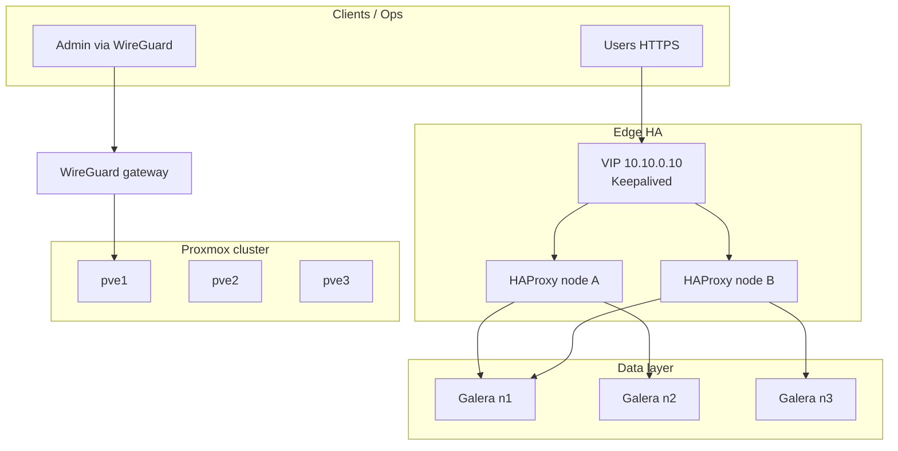

# Proxmox HA Lab

Documentación de un **laboratorio de alta disponibilidad** sobre Proxmox VE: cluster de nodos, balanceo con HAProxy + Keepalived (VIP), base de datos MariaDB Galera y acceso remoto seguro con WireGuard.

Pensado como portfolio técnico para puestos de **infraestructura / SysAdmin / DevOps** (p. ej. Berlín): describe la arquitectura, el porqué de cada pieza y deja configuraciones de ejemplo **sin datos reales**.

## Qué demuestra

- Cluster Proxmox VE (quorum, almacenamiento compartido o réplica)
- VIP flotante con Keepalived (VRRP)
- Balanceo L4/L7 con HAProxy
- MariaDB Galera (multi-master)
- Overlay VPN con WireGuard para administración
- Separación de redes (mgmt / cluster / storage / public)

## Arquitectura (vista rápida)



Detalle en [docs/ARCHITECTURE.md](docs/ARCHITECTURE.md).

## Estructura del repo

```
proxmox-ha-lab/
├── README.md
├── LICENSE
└── docs/
    ├── ARCHITECTURE.md
    ├── RUNBOOK.md
    └── examples/
        ├── haproxy/haproxy.cfg
        ├── keepalived/keepalived.conf
        ├── galera/galera.cnf
        └── wireguard/wg0.conf.example
```

## Configuraciones de ejemplo

| Pieza | Archivo | Notas |
| --- | --- | --- |
| HAProxy | [docs/examples/haproxy/haproxy.cfg](docs/examples/haproxy/haproxy.cfg) | frontend HTTPS + backend Galera/apps |
| Keepalived | [docs/examples/keepalived/keepalived.conf](docs/examples/keepalived/keepalived.conf) | VIP + health check del peer |
| Galera | [docs/examples/galera/galera.cnf](docs/examples/galera/galera.cnf) | cluster name, SST, puertos |
| WireGuard | [docs/examples/wireguard/wg0.conf.example](docs/examples/wireguard/wg0.conf.example) | peers de administración |

Todas las IPs, hostnames y claves son **placeholders** (`10.10.0.0/24`, `REPLACE_ME`, etc.). Sustitúyelas en tu lab; no copies secretos a git.

## Lab mínimo sugerido

| Rol | Cantidad | Ejemplo de recursos |
| --- | --- | --- |
| Nodos Proxmox | 3 | 4–8 vCPU, 16–32 GB RAM, disco SSD |
| VMs HAProxy+Keepalived | 2 | 1–2 vCPU, 1 GB RAM |
| VMs Galera | 3 | 2 vCPU, 4 GB RAM, disco dedicado datos |
| Gateway WireGuard | 1 | 1 vCPU, 512 MB–1 GB RAM |

## Seguridad (checklist)

- [ ] Ninguna IP pública real ni clave en el repo
- [ ] SSH solo por red de mgmt / WireGuard
- [ ] Firewall host + security groups del proveedor
- [ ] Secretos en vault o ficheros fuera de git (`chmod 600`)
- [ ] Backups probados (Proxmox Backup Server o snapshots + dumps Galera)

## Autor

[Agustín Rubí Hernández](https://github.com/AgustinRH)

Licencia: [MIT](LICENSE)
