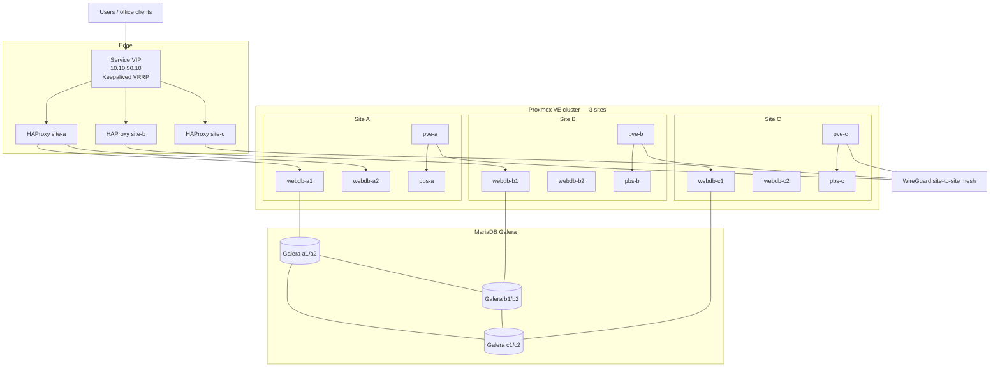

# Multi-site Proxmox HA lab

Portfolio documentation for a **three-site high-availability** stack I designed and operate in production (details anonymized).

One Proxmox VE cluster spans three geographic sites. Application traffic lands on a floating VIP (Keepalived / VRRP) in front of HAProxy. Data is a synchronous MariaDB Galera ring. Sites talk over WireGuard. Backups go to Proxmox Backup Server. Internal git and web content sync use Gitea and Syncthing.

> **Anonymization.** No real company name, hostnames, domains, public IPs, usernames or passwords. Addresses use RFC 1918 / RFC 5737 examples (`10.10.x.x`, `192.0.2.x`). Secrets are `<CHANGE_ME>`. Open `TODO` markers are left where production values belong.

## Architecture

## Stack

| Layer | Choice | Role |
| --- | --- | --- |
| Hypervisor | Proxmox VE (3 nodes, 3 sites) | Single cluster, HA enabled |
| Backup | Proxmox Backup Server (one VM per node) | Snapshot backups of app VMs |
| Database | MariaDB Galera (synchronous) | Multi-master SQL, quorum-aware |
| SQL proxy | ProxySQL on each app VM | Local write preference, read fan-out |
| Edge | HAProxy + Keepalived (VRRP VIP) | L7/L4 distribute + floating service IP |
| Site links | WireGuard mesh | Encrypted overlay between sites |
| Switching | VLAN segmentation + 2× 10GbE per node | Mgmt / Corosync / storage / services |
| Code & files | Gitea + Syncthing | Internal git; sync of web document root |
| OS (guests) | Ubuntu LTS on app VMs | Apache / PHP / MariaDB stack |

Exact package versions and disk sizes: **TODO** (fill from your inventory).

## Design decisions

### Why Galera (synchronous)?

The application is a classic LAMP workload that must see the same rows on every site immediately after a write (orders, stock, office screens). Asynchronous replicas would force sticky sessions or accept stale reads across sites. Galera’s certification-based replication keeps a single logical dataset; ProxySQL on each app VM prefers the local MariaDB for writes and fans reads out when healthy.

Trade-off: you need majority quorum (or a carefully tested last-man procedure). Never bootstrap two donors at once — that splits the dataset.

### Why Keepalived VIPs in front of HAProxy?

Clients and DNS only know one service address. Keepalived moves that VIP with VRRP when the current owner or its HAProxy health check fails. HAProxy then spreads HTTP to healthy backends. Separating “who owns the IP” from “how requests are balanced” keeps failover fast and avoids teaching every client a list of real servers.

All Keepalived instances can run as `BACKUP` with different priorities so the preferred site wins when it is healthy, without a sticky MASTER that refuses to yield.

### Why WireGuard over IPsec?

Site-to-site needs a small, auditable tunnel that carries Corosync, Galera, Syncthing and admin traffic. WireGuard’s single interface, static keys and simple `AllowedIPs` routing are easier to reason about on Linux routers/VMs than a full IPsec/IKE policy set. For this mesh (three peers), operational simplicity beat feature depth. IPsec remains fine where hardware offload or enterprise VPN gear is mandatory — that was not the constraint here.

### Why three sites for quorum?

Three failure domains mean the cluster can lose one entire site and still hold majority for both Proxmox (Corosync) and Galera, as long as the remaining votes stay connected. Two sites alone make “which half is right?” ambiguous on a clean partition. Odd site count is intentional.

## Failure scenarios

| Scenario | Expected behaviour |
| --- | --- |
| **One Proxmox node down** | Remaining nodes keep quorum. Guests on the failed node stay down unless HA is configured for that VM. VIP moves if that node held it. Galera shrinks; survivors stay `Primary`/`Synced` if majority remains. |
| **One site down** (node + its VMs) | Other two sites keep Proxmox + Galera quorum. VIP lands on the next Keepalived priority. PBS at the lost site is offline; other sites’ backup jobs continue. |
| **Network split** between sites | The partition that still has majority votes (and can reach its gateway, if you use a last-man helper) remains quorate. The minority side must **not** force `expected votes` or `galera_new_cluster`. WireGuard recovery should rejoin minorities as joiners, not new primaries. |

Step-by-step behaviour and how to rehearse it: [docs/failover.md](docs/failover.md).

## What I learned

- **Quorum is a product decision**, not only a checkbox. Corosync, Galera and VRRP each have their own majority rules; documenting which layer “wins” under split-brain saves hours during an outage.
- **Last-man helpers are sharp tools.** Automatic vote reduction or Galera bootstrap-on-isolation can keep a single site serving — and can also create two primaries if both sides still see a gateway. Gate them on connectivity checks and a strict priority chain.
- **Backups that never restore are fiction.** PBS jobs per node are simple; a quarterly restore-to-empty-VM test is what makes them real ([docs/backup-and-restore.md](docs/backup-and-restore.md)).
- **Sync tools hate huge first copies.** Syncthing is excellent for ongoing HTML/PHP drift; the initial multi-gig tree is better as a controlled `tar` while the sync service is stopped.
- **Config version skew on Corosync** bites nodes that were offline during a `pvecm` change — copy the live `corosync.conf` before blaming the network.

## Documentation map

| Doc | Contents |
| --- | --- |
| [docs/architecture.md](docs/architecture.md) | VLANs, example IP plan, links, guest layout |
| [docs/failover.md](docs/failover.md) | Node/site failure sequence and test plan |
| [docs/backup-and-restore.md](docs/backup-and-restore.md) | PBS schedule, retention, restore drill |
| [docs/runbook.md](docs/runbook.md) | Add a node, rolling upgrades, Galera health |
| [configs/](configs/) | Sanitized WireGuard, Keepalived, HAProxy, Galera, Proxmox samples — see [configs/README.md](configs/README.md) |

## Author

[Agustín Rubí Hernández](https://github.com/AgustinRH)

License: [MIT](LICENSE)
